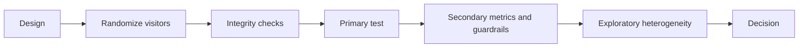
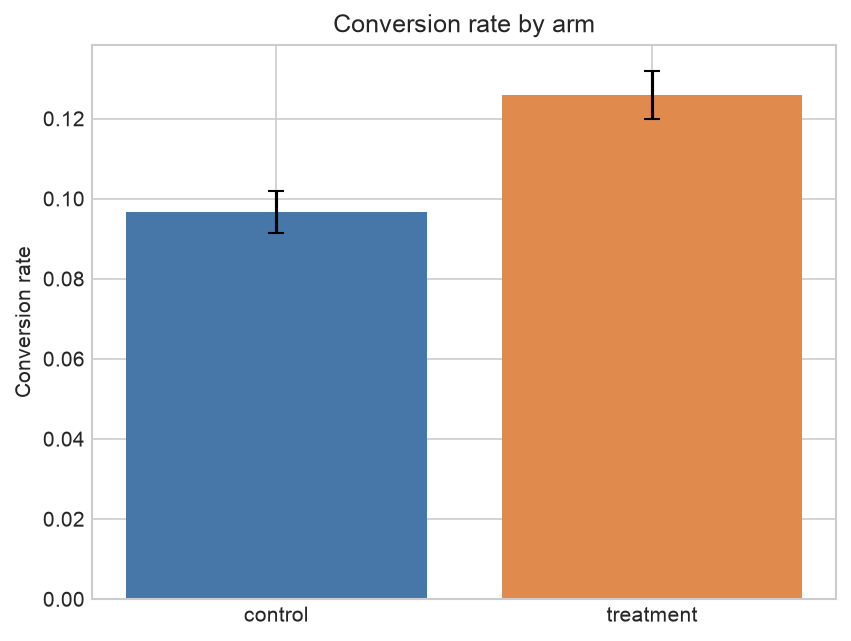
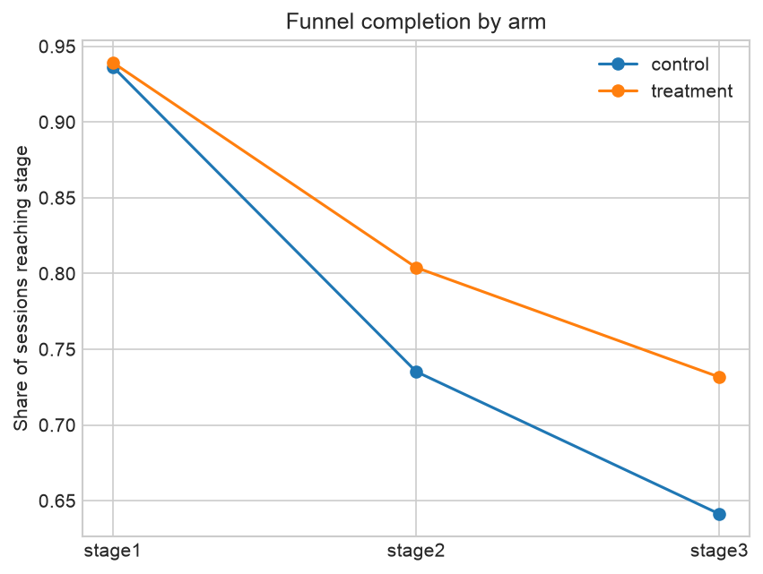
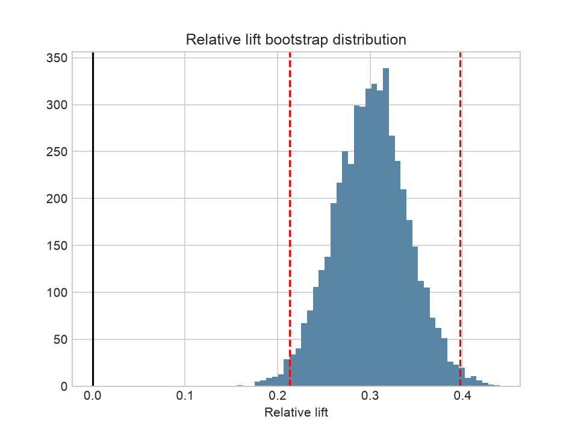
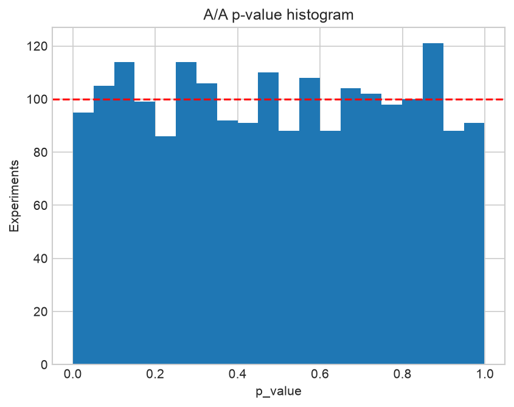

# A/B Testing: E-commerce Checkout Funnel | A/B Testing & Statistical Inference

[](https://github.com/Sritzz-3/ab-testing-checkout-funnel/actions/workflows/ci.yml) [](LICENSE)

This seeded simulation compares a 9.66% control conversion rate with 12.58% under the single-page checkout. Estimated relative lift is 30.20% (95% CI 22.98% to 37.42%; p-value <0.001), while median checkout time fell 49.88%. The predeclared decision is **SHIP**.

> [!IMPORTANT]
> **Simulated data:** No company data is used. The true treatment effects are assumptions in [config.yaml](config.yaml); this analysis estimates them with uncertainty to demonstrate experimental methods, not to claim a real company's outcome. The simulation assumes one eligible session per visitor.

## Business problem and experiment design

The experiment tests the existing 3-step checkout (control) against a redesigned single-page checkout (treatment).

- H0: the conversion rates are equal; H1: they differ (two-sided).
- Primary metric: orders / sessions. Secondary: checkout time and funnel completion. Guardrails: AOV among converters and payment errors.
- Alpha 0.05, target power 0.80, baseline 10.0%, relative MDE 20%.
- Required sample: 3,835 per arm; Planned sample: about 12,000 per arm. Actual arm sizes: 12,068 control and 11,932 treatment.
- Ship rule set before analysis: significant positive primary result with relative CI above zero, AOV non-inferiority above -3%, payment errors within +0.5 pp, and no SRM.



## Results

| Arm | Sessions | Conversions | Rate | Wilson 95% CI |
|---|---:|---:|---:|---:|
| Control | 12,068 | 1,166 | 9.66% | 9.15%–10.20% |
| Treatment | 11,932 | 1,501 | 12.58% | 12.00%–13.19% |

| Measure | Estimate |
|---|---:|
| Absolute lift (pp), Wald 95% CI | 2.92 (2.12, 3.71) |
| Relative lift, delta 95% CI | 30.20% (22.98%, 37.42%) |
| Relative lift, bootstrap 95% CI | 21.27%, 39.70% |
| Two-proportion z p-value | <0.001 |
| Chi-square / Fisher p-values | <0.001 / <0.001 |
| Adjusted odds ratio (95% CI) | 1.344 (1.240, 1.458) |

Checkout time includes sessions that started checkout; this is a selected subset, so treatment effects on who starts can bias the comparison. Median 343.1s to 171.9s (49.88% reduction); mean reduction 50.17%. Mann–Whitney p-value <1e-300; Welch log-time p-value <1e-300.

### Funnel completion by arm

| Funnel stage | Control reached | Control completion | Treatment reached | Treatment completion |
|---|---|---|---|---|
| Stage 1 | 11,301 | 93.64% | 11,207 | 93.92% |
| Stage 2 | 8,873 | 73.53% | 9,593 | 80.40% |
| Stage 3 | 7,739 | 64.13% | 8,730 | 73.16% |

### Guardrails

| Guardrail | Estimate | Confidence bound | Limit | Result |
|---|---|---|---|---|
| AOV among converters (relative difference) | 3.16% | one-sided 95% lower bound -1.65% | -3.00% | PASS ✓ |
| Payment error rate difference | -0.15 pp | one-sided 95% upper bound +0.18 pp | +0.50 pp | PASS ✓ |

### Segment lift (exploratory)

Segment results are exploratory; p-values are Holm-adjusted across the segment tests.

| Dimension | Segment | Relative lift | 95% CI | Holm-adjusted p |
|---|---|---|---|---|
| Device | desktop | 38.33% | 23.96% to 52.69% | <0.001 |
| Device | mobile | 25.17% | 14.54% to 35.80% | <0.001 |
| Device | tablet | 32.56% | 2.28% to 62.85% | 0.0351 |
| User Type | new | 31.97% | 21.47% to 42.47% | <0.001 |
| User Type | returning | 27.33% | 14.08% to 40.57% | <0.001 |
| Traffic Source | direct | 28.96% | 9.07% to 48.86% | 0.0128 |
| Traffic Source | email | 27.23% | 6.79% to 47.66% | 0.0184 |
| Traffic Source | organic | 23.21% | 10.65% to 35.77% | 0.00118 |
| Traffic Source | paid | 43.88% | 27.10% to 60.66% | <0.001 |

### Covariate balance

| Covariate | Balance p-value |
|---|---|
| Device | 0.483 |
| Traffic Source | 0.336 |
| User Type | 0.618 |
| Day Of Week | 0.747 |

### Week 1 vs week 2 stability

| Window | Control conversion | Treatment conversion | Relative lift |
|---|---|---|---|
| Week 1 | 9.54% | 12.29% | 28.77% |
| Week 2 | 9.78% | 12.87% | 31.59% |

Bayesian P(treatment > control) is >99.99%; expected relative lift 30.29% (95% credible interval 21.15% to 39.92%).

## Why the estimated lift exceeds the base assumption

The configured base relative lift is 20%. The simulator increases the treatment effect for mobile visitors and new users, so their higher weighted contributions raise the sample-average estimate above the base assumption. The exploratory segment estimates below show the observed pattern.

## Integrity and validation

- SRM: p-value 0.38, flagged=false.
- A/A false-positive rate=4.75% (Monte Carlo interval 3.82%–5.68%; nominal 5%).
- Simulated power=99.95% at actual sample size.

## Decision and recommendation

**SHIP**

- **Primary test:** two-sided p <0.001 at α=0.05; relative-lift 95% CI 22.98% to 37.42% (lower bound above 0): **PASS ✓**.
- **AOV non-inferiority:** relative difference 3.16%; one-sided 95% lower bound -1.65%, margin -3.00%: **PASS ✓**.
- **Payment error margin:** rate difference -0.15 pp; one-sided 95% upper bound +0.18 pp, limit +0.50 pp: **PASS ✓**.
- **No sample-ratio mismatch:** SRM p 0.38; flag threshold p<0.001, flagged=false: **PASS ✓**.

Limitations: this is simulated data; the randomization unit assumes one eligible session per visitor; checkout-time comparisons condition on starting checkout; segment findings are exploratory; the 14-day window may miss novelty effects; returns and retention are not measured.

## Figures









## How to run

```bash
make setup
make all
```

Reproducibility: Python 3.11.18, seed 42, measured full pipeline runtime 2.34 seconds.

Repository structure:

```text
.github/workflows/ci.yml
.gitignore
LICENSE
Makefile
README.md
README.template.md
config.yaml
data/raw/.gitkeep
notebooks/01_walkthrough.ipynb
outputs/figures/aa.png
outputs/figures/bayesian.png
outputs/figures/conversion.png
outputs/figures/daily.png
outputs/figures/funnel.png
outputs/figures/lift.png
outputs/figures/power.png
outputs/results.json
outputs/tables/aa_pvalues.csv
outputs/tables/balance.csv
outputs/tables/conversion.csv
outputs/tables/daily.csv
outputs/tables/design.csv
outputs/tables/funnel.csv
outputs/tables/guardrails.csv
outputs/tables/power_curve.csv
outputs/tables/sample_size_sensitivity.csv
outputs/tables/segments.csv
outputs/tables/time_stability.csv
requirements.txt
src/__init__.py
src/analysis.py
src/config.py
src/design.py
src/plots.py
src/report.py
src/run_pipeline.py
src/simulator.py
src/validation.py
tests/conftest.py
tests/test_analysis.py
tests/test_design.py
tests/test_report.py
tests/test_simulator.py
tests/test_validation.py
```
