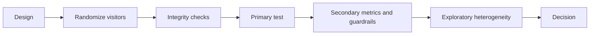
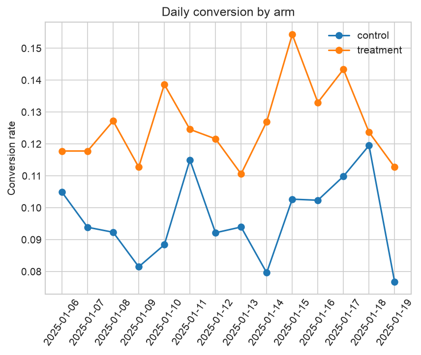
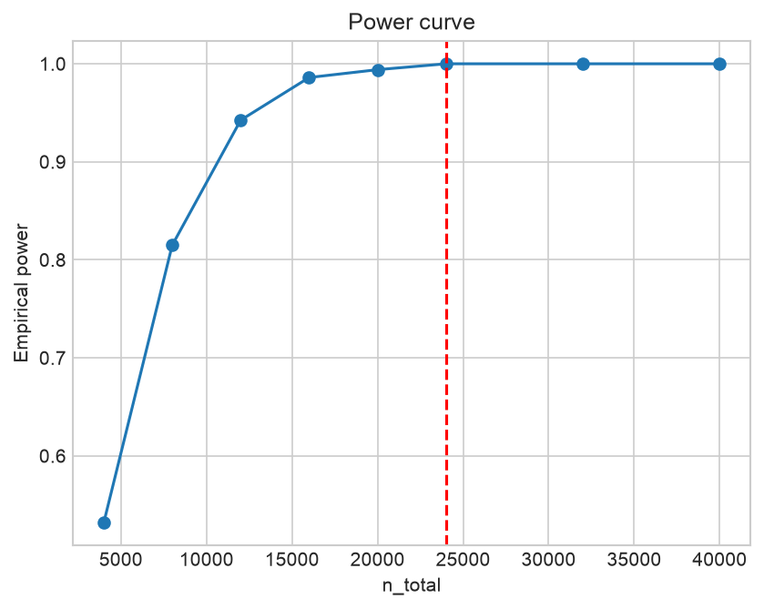
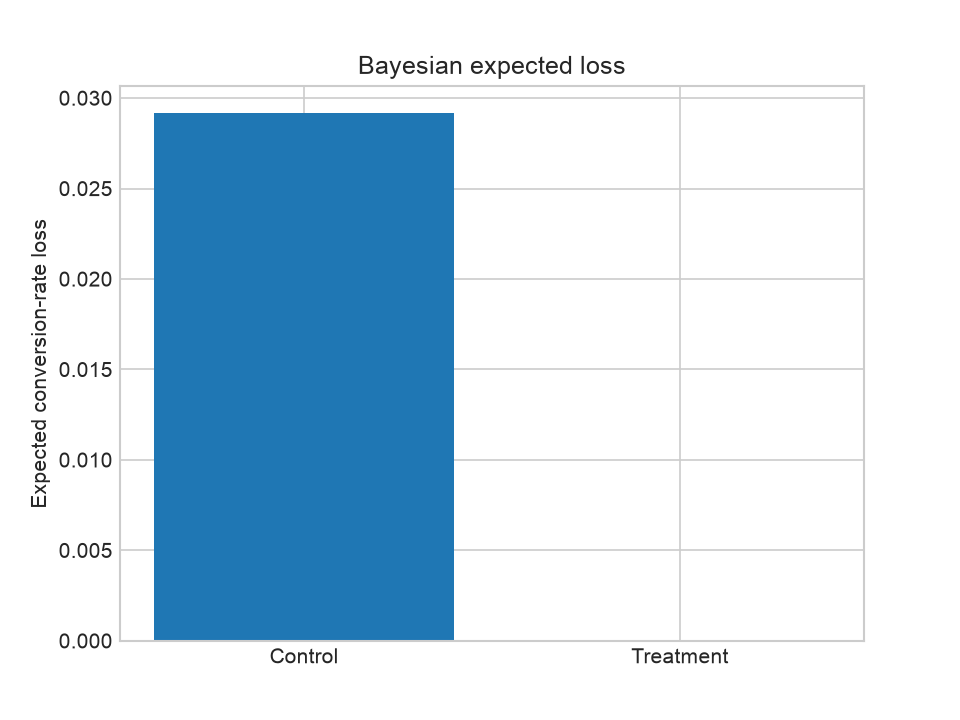

# A/B Testing: E-commerce Checkout Funnel | A/B Testing & Statistical Inference

[](https://github.com/srishtisahu/ab-testing-checkout-funnel/actions/workflows/ci.yml) [](LICENSE)

This seeded simulation compares a 9.66% control conversion rate with 12.58% under the single-page checkout. Estimated relative lift is 30.20% (95% CI 22.98% to 37.42%; p=6.436e-13), while median checkout time fell 49.88%. The predeclared decision is **SHIP**.

> [!IMPORTANT]
> **Simulated data:** No company data is used. The true treatment effects are assumptions in [config.yaml](config.yaml); this analysis estimates them with uncertainty to demonstrate experimental methods, not to claim a real company's outcome. The simulation assumes one eligible session per visitor.

## Business problem and experiment design

The experiment tests the existing 3-step checkout (control) against a redesigned single-page checkout (treatment).

- H0: the conversion rates are equal; H1: they differ (two-sided).
- Primary metric: orders / sessions. Secondary: checkout time and funnel completion. Guardrails: AOV among converters and payment errors.
- Alpha 0.05, target power 0.8, baseline 10.0%, relative MDE 20.0%.
- Required sample: 3835 per arm; actual: 12000 per arm.
- Ship rule set before analysis: significant positive primary result with relative CI above zero, AOV non-inferiority above -3%, payment errors within +0.5 pp, and no SRM.



## Results

| Arm | Sessions | Conversions | Rate | Wilson 95% CI |
|---|---:|---:|---:|---:|
| Control | 12068 | 1166 | 9.66% | 9.15%–10.20% |
| Treatment | 11932 | 1501 | 12.58% | 12.00%–13.19% |

| Measure | Estimate |
|---|---:|
| Absolute lift (pp), Wald 95% CI | 2.92 (2.12, 3.71) |
| Relative lift, delta 95% CI | 30.20% (22.98%, 37.42%) |
| Relative lift, bootstrap 95% CI | 21.27%, 39.70% |
| Two-proportion z p-value | 6.436e-13 |
| Chi-square / Fisher p-values | 6.436e-13 / 6.189e-13 |
| Adjusted odds ratio (95% CI) | 1.344 (1.240, 1.458) |

Checkout time includes sessions that started checkout; this is a selected subset, so treatment effects on who starts can bias the comparison. Median 343.1s to 171.9s (49.88% reduction); mean reduction 50.17%. Mann–Whitney p=0; Welch log-time p=0.

Funnel completion, guardrails, segment estimates with Holm-adjusted p-values, week stability, daily rates and Bayesian summaries are in `outputs/tables/`. Bayesian P(treatment > control)=100.00%; expected relative lift 30.29% (95% credible interval 21.15% to 39.92%).

## Integrity and validation

- SRM: p=0.38, flagged=False.
- Covariate balance p-values: see `outputs/tables/balance.csv`.
- A/A false-positive rate=4.75% (Monte Carlo interval 3.82%–5.68%; nominal 5%).
- Simulated power=99.95% at actual sample size.

## Decision and recommendation

**SHIP.** {'primary': True, 'aov': True, 'payment_error': True}

Limitations: this is simulated data; the randomization unit assumes one eligible session per visitor; checkout-time comparisons condition on starting checkout; segment findings are exploratory; the 14-day window may miss novelty effects; returns and retention are not measured.

## Figures







## How to run

```bash
make setup
make all
```

Reproducibility: Python 3.11.18, seed 42, measured runtime 0.80 seconds.

Repository structure:

```text
.github/workflows/ci.yml
.gitignore
LICENSE
Makefile
README.md
README.template.md
config.yaml
data/raw/.gitkeep
notebooks/01_walkthrough.ipynb
outputs/figures/aa.png
outputs/figures/bayesian.png
outputs/figures/conversion.png
outputs/figures/daily.png
outputs/figures/funnel.png
outputs/figures/lift.png
outputs/figures/power.png
outputs/results.json
outputs/tables/aa_pvalues.csv
outputs/tables/balance.csv
outputs/tables/conversion.csv
outputs/tables/daily.csv
outputs/tables/design.csv
outputs/tables/funnel.csv
outputs/tables/guardrails.csv
outputs/tables/power_curve.csv
outputs/tables/sample_size_sensitivity.csv
outputs/tables/segments.csv
outputs/tables/time_stability.csv
requirements.txt
src/__init__.py
src/analysis.py
src/config.py
src/design.py
src/plots.py
src/report.py
src/run_pipeline.py
src/simulator.py
src/validation.py
tests/test_analysis.py
tests/test_design.py
tests/test_report.py
tests/test_simulator.py
tests/test_validation.py
```
