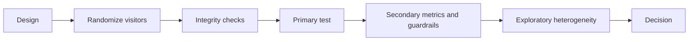
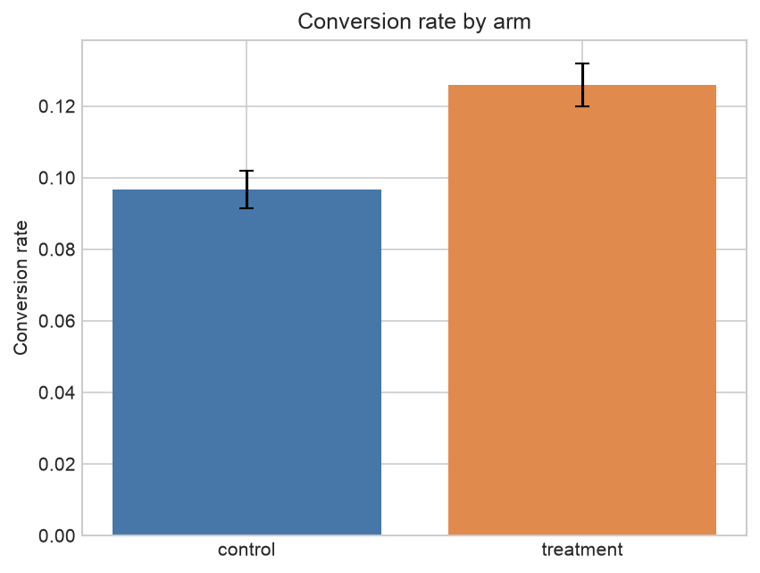
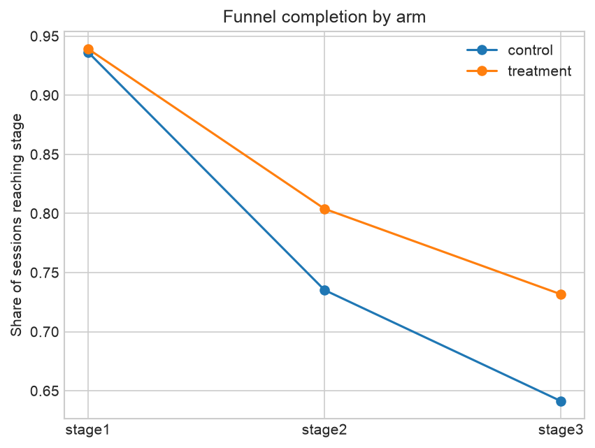
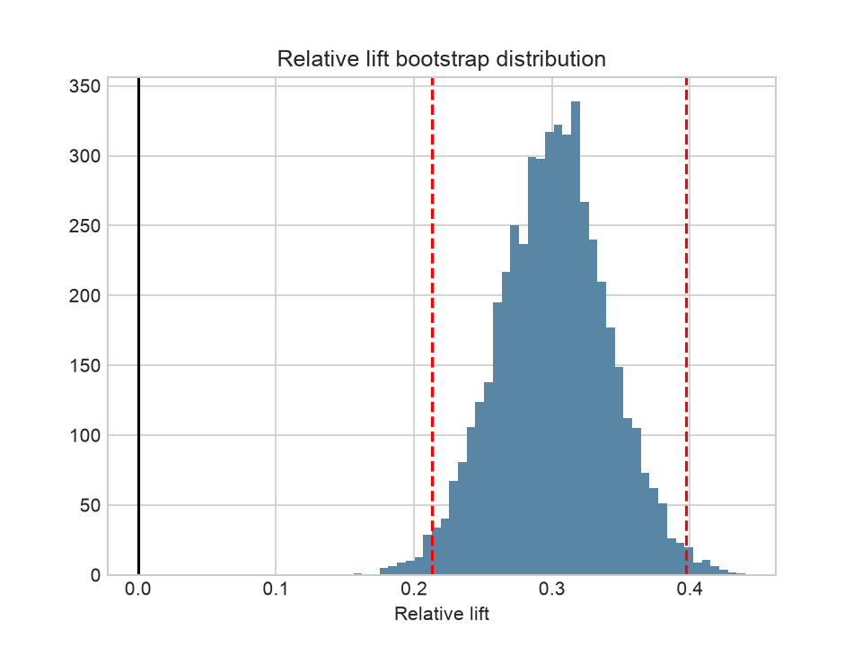
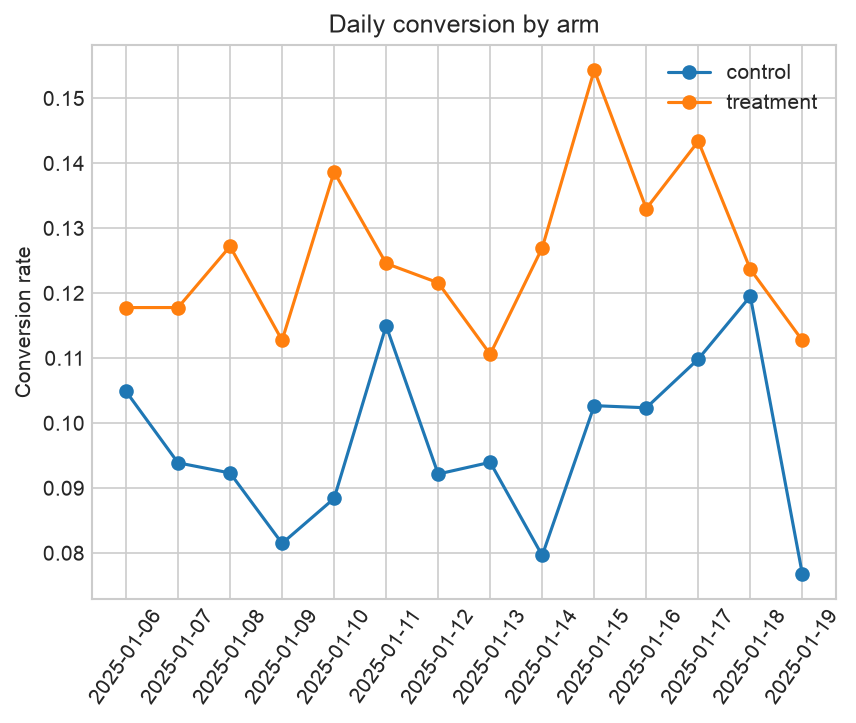
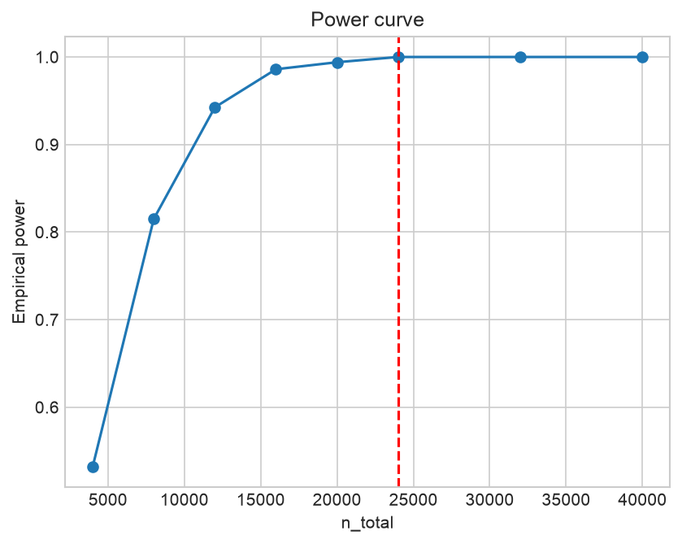
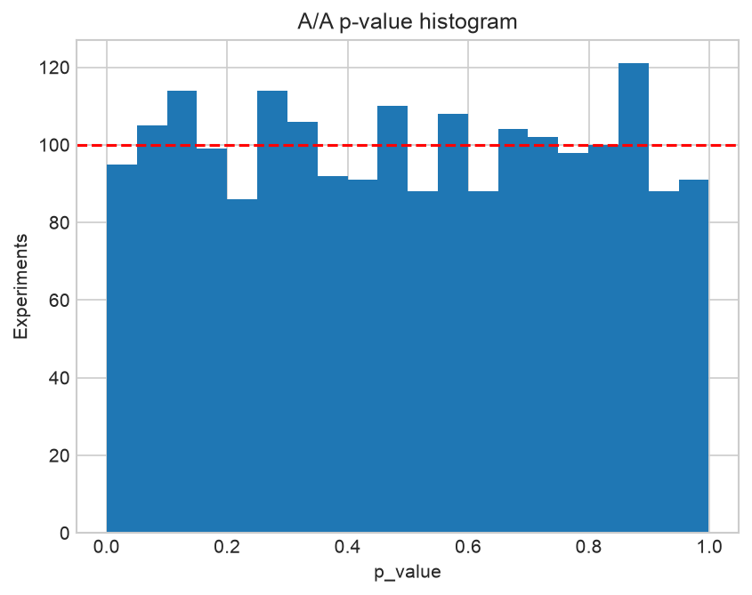
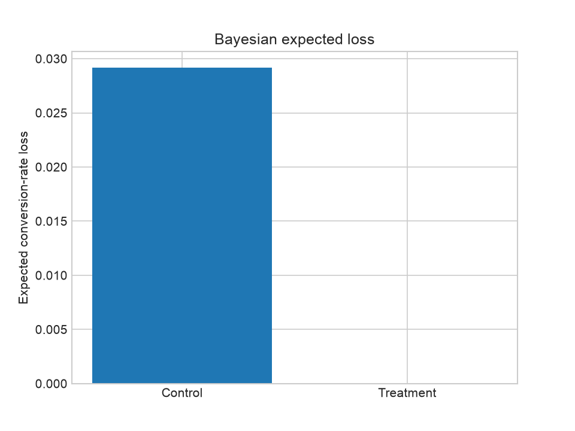

# A/B Testing: E-commerce Checkout Funnel | A/B Testing & Statistical Inference

[](https://github.com/{{github_path}}/actions/workflows/ci.yml) [](LICENSE)

This seeded simulation compares a {{control_rate_pct}}% control conversion rate with {{treatment_rate_pct}}% under the single-page checkout. Estimated relative lift is {{relative_lift_pct}}% (95% CI {{relative_ci_low_pct}}% to {{relative_ci_high_pct}}%; p={{p_value}}), while median checkout time fell {{time_reduction_pct}}%. The predeclared decision is **{{decision}}**.

> [!IMPORTANT]
> **Simulated data:** No company data is used. The true treatment effects are assumptions in [config.yaml](config.yaml); this analysis estimates them with uncertainty to demonstrate experimental methods, not to claim a real company's outcome. The simulation assumes one eligible session per visitor.

## Business problem and experiment design

The experiment tests the existing 3-step checkout (control) against a redesigned single-page checkout (treatment).

- H0: the conversion rates are equal; H1: they differ (two-sided).
- Primary metric: orders / sessions. Secondary: checkout time and funnel completion. Guardrails: AOV among converters and payment errors.
- Alpha {{alpha}}, target power {{target_power}}, baseline {{baseline_pct}}%, relative MDE {{mde_pct}}%.
- Required sample: {{required_n}} per arm; actual: {{actual_n}} per arm.
- Ship rule set before analysis: significant positive primary result with relative CI above zero, AOV non-inferiority above -3%, payment errors within +0.5 pp, and no SRM.



## Results

| Arm | Sessions | Conversions | Rate | Wilson 95% CI |
|---|---:|---:|---:|---:|
| Control | {{control_n}} | {{control_conversions}} | {{control_rate_pct}}% | {{control_wilson_low}}%–{{control_wilson_high}}% |
| Treatment | {{treatment_n}} | {{treatment_conversions}} | {{treatment_rate_pct}}% | {{treatment_wilson_low}}%–{{treatment_wilson_high}}% |

| Measure | Estimate |
|---|---:|
| Absolute lift (pp), Wald 95% CI | {{absolute_lift_pp}} ({{absolute_ci_low_pp}}, {{absolute_ci_high_pp}}) |
| Relative lift, delta 95% CI | {{relative_lift_pct}}% ({{relative_ci_low_pct}}%, {{relative_ci_high_pct}}%) |
| Relative lift, bootstrap 95% CI | {{bootstrap_ci_low_pct}}%, {{bootstrap_ci_high_pct}}% |
| Two-proportion z p-value | {{p_value}} |
| Chi-square / Fisher p-values | {{chi_square_p}} / {{fisher_p}} |
| Adjusted odds ratio (95% CI) | {{adjusted_or}} ({{adjusted_or_low}}, {{adjusted_or_high}}) |

Checkout time includes sessions that started checkout; this is a selected subset, so treatment effects on who starts can bias the comparison. Median {{control_median}}s to {{treatment_median}}s ({{time_reduction_pct}}% reduction); mean reduction {{mean_reduction_pct}}%. Mann–Whitney p={{mann_whitney_p}}; Welch log-time p={{welch_log_p}}.

Funnel completion, guardrails, segment estimates with Holm-adjusted p-values, week stability, daily rates and Bayesian summaries are in `outputs/tables/`. Bayesian P(treatment > control)={{bayes_probability}}%; expected relative lift {{bayes_lift_pct}}% (95% credible interval {{bayes_ci_low_pct}}% to {{bayes_ci_high_pct}}%).

## Integrity and validation

- SRM: p={{srm_p}}, flagged={{srm_flag}}.
- Covariate balance p-values: see `outputs/tables/balance.csv`.
- A/A false-positive rate={{aa_rate_pct}}% (Monte Carlo interval {{aa_ci_low_pct}}%–{{aa_ci_high_pct}}%; nominal 5%).
- Simulated power={{empirical_power_pct}}% at actual sample size.

## Decision and recommendation

**{{decision}}.** {{decision_reason}}

Limitations: this is simulated data; the randomization unit assumes one eligible session per visitor; checkout-time comparisons condition on starting checkout; segment findings are exploratory; the 14-day window may miss novelty effects; returns and retention are not measured.

## Figures









## How to run

```bash
make setup
make all
```

Reproducibility: Python {{python_version}}, seed {{seed}}, measured runtime {{runtime_seconds}} seconds.

Repository structure:

```text
{{file_tree}}
```
